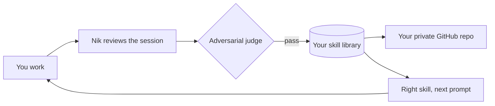

# NowItKnows

### Your coding agent finally remembers how you work.

    

A new Claude Code or Codex session doesn't reliably know how you work. It forgets your release order. It walks into the same pitfall it hit last week. It works out again what it already figured out yesterday, or gets it wrong.

**NowItKnows, Nik for short, fixes that.** You just work. Nik watches how your sessions go, works out what's worth keeping, and turns it into skills. Next time that kind of task comes up, your agent already knows how you do it.

No prompts to write. No skills to maintain. It learns from what you tell it and from what it figures out on its own.

## When Nik helps

| When | What Nik does | What we measured |
|---|---|---|
| You've told your agent how something works | Remembers it in later sessions | **24 of 24** tasks with Nik, vs 8 without on Claude Code and 6 without on Codex. The skill loaded in **18 of 18** later sessions |
| The answer is in the repo, if your agent looks | Often works it out and keeps it | Saved a correct skill in **3 of 6** task sequences on Claude Code and **5 of 6** on Codex, and no wrong ones. Tasks passed came out about even |
| Your agent would otherwise wander | Goes straight to what worked | **34% fewer tokens** on the task where it wandered most, once taught |
| Your agent already gets it right | Adds little | **16% more tokens** on Claude Code, 9% fewer on Codex |

Across all three tasks, once taught: 12% fewer tokens on Claude Code, 7% fewer on Codex. With no teaching: 20% more on Claude Code, about even on Codex. Nik is for getting it right without repeating yourself. It isn't a token saver everywhere. [The fine print](#the-fine-print).

## Install

You need git, [uv](https://docs.astral.sh/uv/) 0.9.5 or later, and Claude Code 2.1.301 or later or Codex. One command sets up every app it finds:

```sh
git clone https://github.com/theaigroup-ai/nowitknows.git && cd nowitknows && uv run --frozen --python ">=3.14" --project plugin python plugin/bin/nowitknows.py setup
```

Restart your app. In Codex, review and trust the hooks in `/hooks`. Then go back to work.

Just want the Claude Code plugin? In a terminal:

```sh
claude plugin marketplace add theaigroup-ai/nowitknows --sparse .claude-plugin plugin
claude plugin install nowitknows@nowitknows
```

Then run `claude plugin update nowitknows@nowitknows` to get new versions.

## Your skills, in your own GitHub

This is the part we're proudest of. After setup, turn it on in a terminal, from the same folder:

```sh
uv run --frozen --python ">=3.14" --project plugin python plugin/bin/nowitknows.py setup --git
```

Say yes when asked, and Nik creates a private GitHub repo for your skills and keeps it current for you. Installed only the plugin? Choose git in `/nowitknows:setup` and it prints the command to run.

- **Every skill change is committed and pushed automatically.** A background job does it, with no model involved and nothing for you to remember.
- **Your skills come with you.** New laptop? Point setup at your repo and your skills are back. Skills work in every clone and worktree you have.
- **It's your library.** Plain Markdown, in your repo, with full history. Read it, edit it, diff it, roll it back.
- **Private by default, and it checks.** Nik confirms the repo is private before every push, scans for secrets, and if two machines change the same skill, keeps both versions.

## What else Nik does

- **Learns while you work.** After a session, a background reviewer reads what happened: what worked, what broke, what you corrected. The lessons become skills on their own.
- **Keeps itself honest.** An adversarial judge has to pass every skill change from a background review before it applies, so made-up rules get caught instead of becoming habits. Your agent's own edits and time-based archiving are logged, not judged.
- **Brings the right skill at the right moment.** Each prompt is matched against everything your agent has learned, in about 100 ms on a Mac with 1,000 skills.
- **Makes Claude Code and Codex share a brain.** What one learns, the other knows: skills, memory and session history.
- **Remembers you.** A short profile and your standing conventions load into every session, in every project.
- **Finds what you did last month.** Your agent can search your past sessions, and archived transcripts outlive Claude Code's 30-day cleanup, up to 1 GiB by default, oldest removed first.
- **Never loses a skill.** Every skill change is logged and reversible, unused skills are archived and never deleted, and you see each change as one line.
- **Shows you whether it's paying off.** `/nowitknows:report` shows where your tokens go each week, what Nik itself spent, and how sessions with a learned skill compare with sessions without, in your own repos. It says so when Nik costs more than it helps. It keeps counts only, never your conversations, nothing leaves your machine, and one setting turns it off.
- **Runs on your login, on your machine.** Your own Claude or ChatGPT subscription through your own CLI. No API keys, no signup, no server, no telemetry sent off your machine.

## See it work

**Monday.** You're just releasing. The release script fails because VERSION and package.json don't match, your agent sorts it out, and you move on. When that session's review finishes, you get one line:

```
NowItKnows · created skill release-ferrylog-cli (judge: pass)
```

**Thursday.** A brand-new session:

> Release 1.2.0.

Your agent gets the skill with the prompt and does it right the first time. Nobody explained anything twice.

*(An illustrative example.)*

## How it works



## The fine print

Each comparison is 48 sessions: the same model and tasks, with and without Nik, and with the host's own memory on. Numbers are averages across runs, rounded down, and the no-teaching task counts come from the final run. The pass bars for tasks, learning and total tokens were written down before any session ran. The two token rows in the table are slices of those runs, 16 sessions each, chosen afterwards, so read them as a direction and not a promise.

- The tasks are repeat work, with a procedure and a pitfall that come back. That's what Nik is built for. The repos are small, and we haven't measured large real-world repos yet.
- When you've told it: the first session of each task states how it's done, and the repo doesn't say, so an agent without Nik rarely gets it right later (about 2 of 18 later sessions). The gap is this large partly for that reason.
- When the answer is in the repo: every session gets only the goal, and the rules are there to read in a small repo, the easy case for an agent on its own. Tasks passed were 22 of 24 vs 19 on Claude Code and 20 of 24 vs 16 on Codex, and we read that as even. Claude Code's gain came on a task where Nik saved nothing. Codex's came from one task, in a run where Codex alone passed none of that task, and an earlier run went 16 vs 17.
- When your agent would wander: the figure comes from the taught runs. In those same runs the other two tasks used 9% more tokens on average.
- When it already gets it right: these tasks passed every time on both sides, across two no-teaching runs.
- The score without Nik varies between runs: Claude Code alone passed 7 of 24 in one run and 12 of 24 in another. Token totals differed by 19% between two identical runs, and by up to 59% on a single task, so treat small differences as noise.
- Tokens are tokens processed, including cached input. They aren't your bill.

Against Hermes Agent as installed, on an earlier release: 24 of 24 vs 7 of 24 tasks, at 0.69 times its tokens. Nik's reviewer prompt was adapted from Hermes Agent (MIT), with thanks.

## Know before you install

- Real use and these benchmarks are on macOS. On Windows, Claude Code and the Codex CLI pass install, hook and tool probes, and real sessions still need confirmation. Linux has automated test runs only. A Cursor edition is included but isn't proven yet, and doesn't run on Windows.
- Learning needs a Claude or ChatGPT subscription login, never an API key, and it spends your plan's tokens on background reviews.
- GitHub backup needs the `gh` CLI, installed and logged in.
- It relies on Claude Code and Codex internals that can change.
- Skill matching uses words, not meaning: the right skill lands in the top 3 for 79% of our test prompts.

The [full guide](plugin/README.md) covers settings, recovery, everything Nik runs, reads and writes, and the [complete limits](plugin/README.md#limits). Also see the [security policy](SECURITY.md) and [MIT license](LICENSE).
